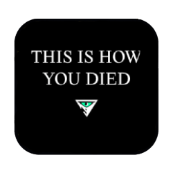

# The endgame you've been waiting for! 🕰️⚰️



TIHYD (pronounced **TIDE**) is a mod that focuses on adding fully configurable character aging functionality. As a mod that will rarely be experienced, it is guaranteed to test commitment to favorite characters.
  
_The repository folder structure is in accordance with the PZ Steam Workshop guidelines._

## Installation 🛠️ 

- Clone the repository:

  ```shell
  git clone https://github.com/Dy0gu/TIHYD.git
  ```

- For a local Build 42 installation, copy `TIHYD/Contents/mods/TIHYD` into `~/Zomboid/mods/`.
- For Workshop development and uploading, copy the outer `TIHYD` folder into `~/Zomboid/Workshop/` instead. Do not keep duplicate local and Workshop copies enabled.

The mod uses Build 42's versioned layout: reusable Lua, sandbox options, and translations live in `common/media/`, while Build 42 metadata and the poster live in `42/`. This layout does not provide Build 41 support.
  
## Usage ▶️ 

- Launch the game and activate the mod in the respective panel.
- Set **Days per year** in the mod's sandbox options to choose how many in-game survival days count as one year of character age (default: **365**, range: **1–36500**). This is useful with mods such as **Surviving Through Seasons** that change the length of a year; it changes TIHYD's aging calculation, not the game's calendar or day length. Changing the setting in an existing save recalculates age from total survival time.

## Acknowledgments ©️

Thank you to all the contributors behind the [Umbrella](https://github.com/asledgehammer/Umbrella) collection, which provides EmmyLua typings for the Project Zomboid API, massively speeding up development time!
